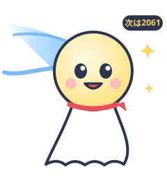

# 06. ゆるキャラ案

日原天文台の公式キャラクター案。ラフ画は [`docs/mascot/`](mascot/) にある SVG(イラストレーターに渡す前のたたき台)。

## 前提

- 既存の公式キャラクターは見つからなかった(2026-10 時点の検索)。施設・町に念のため確認すること。
- 「はれるん」は気象庁のマスコットと同名のため候補から外した。
- 名前は候補。決める前に **J-PlatPat での商標検索** と、同名キャラの有無の検索を行うこと。

## 推しポイントの整理(キャラに込める要素)

| 要素 | 由来 |
| --- | --- |
| ドーム | 天文台の見た目そのもの。シルエットで一目でわかる |
| 枕瀬山(まくらせやま) | 天文台がある山の名前。「まくら」→ 昼は寝て夜起きる天文台らしさ |
| 1985年・ハレー彗星 | 開設の年。次にハレー彗星が来るのは 2061年 |
| 「晴れ」 | 観望会は晴れが命。ハレー(Halley)と晴れの掛けことば |
| 願い星★宅配便 | 天文台だけの体験。郵便屋さんにできる |
| 昼も夜も | 昼は太陽・昼間の星、夜は天体観望。キャラの「昼/夜の顔」に使える |

---

## 案A:マクラン【推し】

 

| 項目 | 設定 |
| --- | --- |
| 名前 | マクラン(枕瀬山の「まくら」から) |
| 正体 | 枕瀬山のてっぺんに住む、天文台のドームの子 |
| 誕生日 | 1985年8月(天文台の開設月。日付は施設に確認) |
| 好きなもの | 晴れた夜、星の形のまくら、ハレー彗星の思い出 |
| 苦手なもの | くもり空、まぶしいライト |
| 口ぐせ | 「今夜は晴れるかな〜」 |
| 特徴 | 昼はスリット(頭のすじ)を閉じてお昼寝。夜になるとスリットが開いて、頭の中から星がのぞく |

**推す理由**
- **地名が由来**で、ほかの天文台にはまねできない。
- ドームのシルエットなので、**ロゴやアイコンにしても天文台だとわかる**。
- 「昼はねむい/夜は元気」の2つの顔を、サイトの昼夜の案内、開催・中止のお知らせにそのまま使える。

## 案B:ハレぼう

| 項目 | 設定 |
| --- | --- |
| 名前 | ハレぼう(ハレー彗星+晴れ+てるてる坊主) |
| 正体 | 1985年に日原の空へやってきたハレー彗星のかけら。てるてる坊主の姿で、観望会の夜を晴れにする |
| 夢 | 2061年に戻ってくる「お母さん彗星」(ハレー彗星)と、天文台の望遠鏡で再会すること |
| 特徴 | 頭が彗星の核、うしろに青いしっぽ。首に赤いリボン |

**良いところ**:開設の物語(1985年)と、未来への約束(2061年)を1体で語れる。「2061年まであと○年」カウントダウンの企画にできる。
**注意点**:てるてる坊主は形がよくあるので、しっぽのデザインで個性を出す必要がある。

## 案C:ポラリ

| 項目 | 設定 |
| --- | --- |
| 名前 | ポラリ(北極星ポラリスから。旧サイトのアドレス `~polaris` にもちなむ) |
| 正体 | 「願い星★宅配便」の配達員。ポストに入った願いごとを星まで届ける |
| 性格 | まじめで、ぜったいに道に迷わない(北極星なので) |
| 特徴 | 星の形の体に郵便帽、肩かけかばん |

**良いところ**:願い星★宅配便の案内役になり、Phase 3 の「願い星オンライン」の顔にできる。グッズ(はがき・切手風シール)と相性が良い。
**注意点**:星形キャラは全国にとても多い。単体では日原らしさが弱い。

## 番外:ほしさぎ(図なし)

津和野の**鷺舞(さぎまい)**の鷺が、夜は星を見上げる天文博士になる案。津和野町全体との連携には強い。
ただし鷺舞は国の重要無形民俗文化財で地域の大切な神事のため、モチーフに使うなら保存会・町と相談が必須。

---

## おすすめの組み合わせ

**メイン:マクラン/サブ:ハレぼう**

> 1985年の夏、ハレー彗星といっしょに枕瀬山に生まれた天文台の子・マクラン。
> そのとき空から落ちてきた彗星のかけら・ハレぼうと友だちになった。
> ハレぼうのお母さん(ハレー彗星)が帰ってくるのは2061年。
> それまでマクランは、毎晩みんなと空を見上げて待っている。

- マクラン:天文台そのものの顔(ロゴ・サイト・看板・案内)
- ハレぼう:晴れ祈願・天気の話・2061年カウントダウン(SNS・イベント)
- ポラリ:願い星★宅配便の専用キャラとして、あとから追加してもよい

## サイトでの使いみち(採用後)

| 場所 | 使い方 |
| --- | --- |
| トップの「今日の日原天文台」 | 開催=夜のマクラン、中止=くもり空でしょんぼり、休館日=お昼寝マクラン |
| 404ページ | 「マクランがお昼寝中に、ページがどこかへ行っちゃった」 |
| 赤色ナイトモード | 赤一色の線画マクランに切り替え |
| favicon・OGP 画像 | ドームのシルエット |
| イベント告知 | ハレぼうが「今夜は晴れるかな?」 |
| SNS | キャラの一人称で天文現象を紹介(中の人は地域おこし協力隊のガイドなど) |

## 次のステップ

1. 施設・町に案を見せて方向性を決める(A〜C、または組み合わせ)
2. 名前の商標・同名キャラ調査
3. イラストレーターに清書を依頼(このラフと設定を渡す)。**著作権の帰属**(町/指定管理者)と二次利用範囲を契約に明記
4. 余力があれば、名前やデザインを**地元の小中学生から公募**する。地域の愛着づくりとニュースになるきっかけを兼ねる
5. 利用ガイドライン(色・使ってはいけない加工・申請方法)を作り、地元のお店がグッズやお菓子に使えるようにする
